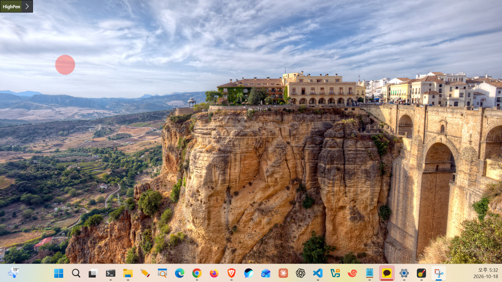

# HighPen

- **한국어:** [한국어로 된 문서는 여기를 보세요.](README.md)
- **English:** You are reading this document.
- **日本語:** [日本語版のドキュメントはこちらです。](README.ja.md)

HighPen is a Windows pen app for online lectures. You can write directly on the screen, highlight the mouse pointer with a spotlight, zoom in on the screen, and bring up a whiteboard. It works with pen tablets such as Wacom (Windows Ink) as well as with a mouse.

## Installation

### Run without installing

Download [HighPen.exe](https://github.com/stepanowon/high-pen/raw/main/dist/HighPen.exe) and run it directly. No installation needed.

### Install with the installer

1. Download [HighPen-Setup.exe](https://github.com/stepanowon/high-pen/raw/main/dist/HighPen-Setup.exe) and run it.
2. Confirm the installation and choose whether to create a desktop shortcut.
3. When the installation finishes, you can start the app right away.

- Install location: `%LOCALAPPDATA%\Programs\HighPen` (no administrator rights needed)
- A Start menu shortcut is created.
- Running the same file again overwrites the installed copy to update it.
- Uninstall: remove HighPen from **Installed apps** in Windows Settings, or run `Uninstall.exe` in the install folder. Saved settings (`%APPDATA%\HighPen`) are kept.
- Silent install/uninstall: `HighPen-Setup.exe /S`, `Uninstall.exe /S`
- The installer messages follow the Windows display language (Korean, Japanese, otherwise English).

### Pin to the taskbar

While the app is running, the HighPen icon appears on the taskbar. Right-click it and choose **Pin to taskbar** so you can start it from the icon next time, even when the app is closed.

### Requirements

Windows 10/11 (.NET Framework 4.8 is built in, nothing else to install)

## Usage

When you start the app, the toolbar appears in the top-left corner of the active monitor. Drag the top row (HighPen) to move it; the position is remembered. Use the `<` button to collapse and expand it.

### Changing the language

The default language is **English**. On first launch, buttons and tooltips are shown in English. You can switch while the app is running:

1. Click **Settings** on the toolbar or press `Ctrl+Alt+D` to open the settings panel.
2. Under **Language** near the bottom of the panel, click **日本語** or **한국어**.
3. The change applies immediately without restarting, and the current state (pen, zoom, etc.) is kept.

The chosen language is saved automatically and used on the next launch.

Shortcuts are global, so they work while you are using other programs. A combination already used by another program may fail to register. Hovering over a button shows its name and shortcut as a tooltip.

| Button | Shortcut | Function |
|---|---|---|
| Spot | Ctrl+Alt+S | Turns the round spot that follows the mouse pointer on/off. Clicks pass through to the screen below. |
| Pen | Ctrl+Alt+P | Writes on the screen. When the pen is turned off, the ink stays on screen and the mouse passes through to the screen below. Switches back to the pen from eraser or note mode. |
| Eraser | Ctrl+Alt+E | Erases whole strokes. Pressing it again while erasing deletes all pen ink and notes on the current page. |
| Board | Ctrl+Alt+B | Cycles white board → black board → off. Ink on the screen and on the two boards is kept separately. |
| Undo | Ctrl+Alt+Z | Cancels the last pen stroke or eraser action. |
| Clear | Ctrl+Alt+C | Clears all ink and notes on the current page. |
| Note | Ctrl+Alt+T | Places a text note where you click. Enter confirms, Shift+Enter adds a line break, Esc cancels. |
| Zoom | Ctrl+Alt+X | Zooms the monitor under the mouse pointer (1.5x, 2x or 2.5x, chosen in Settings). |
| Settings | Ctrl+Alt+D | Opens and closes the settings panel. |
| `<` | Ctrl+Alt+H | Collapses and expands the toolbar. |
| Red X | Ctrl+Alt+Q | Quit |

### Settings panel

| Item | Shortcut | Description |
|---|---|---|
| Monitor | Ctrl+Alt+M (cycle) | Selects the monitor the app works on. Ink, spot, board and toolbar appear only on the selected monitor. |
| Pen color | Ctrl+Shift+first letter of the color | Red R, Orange O, Yellow Y, Green G, Blue B, Purple P, Black K (B is taken by Blue), White W |
| Pen width | | 1–30 |
| Pressure | Ctrl+Alt+R | The harder you press the pen, the thicker the line. A mouse always draws at the set width. |
| Spot color / size | | 8 colors and sizes 20–200. |
| Language | | Choose 한국어, 日本語 or English; the change applies immediately. The default is English (see [Changing the language](#changing-the-language)). |
| Version | | The current version (`HighPen v1.2.0`) is shown at the bottom of the panel. |

Settings are saved automatically to `%APPDATA%\HighPen\settings.txt`.

### Writing while zoomed

If you turn on the pen while zoomed, the zoomed view freezes in place so you can write exactly where you see things. Turning the pen off makes the zoomed view follow the pointer again. Ink is stored in original screen coordinates, so when you turn zoom off it stays on the same content at normal size.

## Features

### Mouse spot

A semi-transparent round spot follows the mouse pointer so viewers can easily find it.

- The spot does not catch clicks, so you can use the screen below as usual.
- Change its color (8 colors) and size (20–200) in the settings panel. It is a plain colored circle without a border.
- It is shown only on the monitor selected as the active monitor.

### Pen (writing)

A transparent ink layer covers the screen so you can draw directly on it. Both Wacom pens and the mouse work.

- **Pen on:** the screen enters writing mode and clicks to the screen below are blocked.
- **Pen off:** your ink stays on screen and the mouse controls the screen below again. You can advance slides with the ink still showing.
- **Color and width:** 8 colors, width 1–30. Colors can also be changed with shortcuts.
- **Pressure:** when on, pressing harder makes lines thicker; the set width corresponds to medium pressure. A mouse draws at a constant width. If pressure does not work, check that Windows Ink is enabled in the Wacom driver.
- **Smoothing:** lines are smoothed into curves.

### Eraser

Passing over a stroke erases the whole stroke (stroke erasing). The eraser end of a Wacom pen also works.

- Pressing Ctrl+Alt+E again while in eraser mode deletes all pen ink and notes on the current page at once. Other pages are not affected.
- To write again, press the pen button (Ctrl+Alt+P).

### Board

Covers the whole screen with a white or black board to write on. Each press of the board button cycles white board → black board → off.

- Ink on the screen, the white board and the black board is kept separately. Turning a board off and on keeps its content, and board ink does not mix with the on-screen ink.
- A black pen on the black board or a white pen on the white board would be invisible, so the pen switches to the opposite color automatically.
- Zoom does not apply to ink on a board.

| White board | Black board |
|---|---|
|  |  |

### Undo / Clear

- **Undo:** cancels the last action on the current page: one pen stroke, or all strokes removed by one eraser drag. Clear all cannot be undone. Notes cannot be undone.
- **Clear:** removes all ink and notes on the current page. Other pages (screen, white board, black board) are not affected.

### Notes

Attaches a text note to the screen. Use it to leave terms or explanations in clear type instead of handwriting.

1. Press the note button (Ctrl+Alt+T). The pointer changes to a text cursor.
2. Click where you want the note and type its content.
3. Press **Enter** to confirm. **Shift+Enter** adds a line break and **Esc** cancels.

- The note is shown as a rounded white box with a border in the current pen color, and the font size scales with the pen width.
- After one note the app returns to normal pen mode. Press the button again for each additional note.
- Notes cannot be moved or edited after they are created; they can only be removed with Clear.
- Notes belong to the current page (screen, white board, black board) and are kept per page.

### Zoom

Zooms the monitor under the mouse pointer in real time. Pick 1.5x, 2x or 2.5x in the settings panel; changing it while zoomed applies immediately.

- The view moves so that the content under the pointer stays under the pointer after zooming. Just click where you see things.
- The toolbar is not zoomed and keeps its normal size.
- The monitor the pointer was on when zoom was turned on is zoomed, and the pointer cannot leave that monitor while zoomed. To zoom another monitor, turn zoom off, move the pointer, and turn it on again.
- **Writing while zoomed:** turning on the pen freezes the zoomed view so you can write where you see things. Turning the pen off makes the zoomed view follow the pointer again. Ink is stored in original screen coordinates, so it stays on the same content at normal size when zoom is turned off. To move to another area while zoomed, turn the pen off, move the pointer, and turn the pen on again.

### Multiple monitors

Choose the monitor the app works on with **Monitor** in the settings panel (or Ctrl+Alt+M). Ink, spot, board and toolbar appear only on that monitor, and the other monitors can be used as usual. Existing ink and notes are kept when you switch monitors. The numbers match those in Windows display settings.

### Toolbar

- Drag the top row (HighPen) to move the toolbar; the position is saved and used on the next launch. If the saved position is off screen, it returns to the top-left corner.
- Use the `<` button to collapse and expand it. When collapsed, only the HighPen title row remains, as shown below.

  

- Hovering over a button shows its name and shortcut as a tooltip.
- Clicking it does not take focus away from the screen you are presenting.
- While running, its icon appears on the taskbar and can be pinned.

### Saved settings

Pen color, width, pressure, spot color and size, whether the spot is on, the active monitor, the toolbar position and the language are saved automatically to `%APPDATA%\HighPen\settings.txt` and reused on the next launch.

## Notes / limitations

- The installer is not code-signed, so Windows SmartScreen may show a warning on other PCs.
- Monitors connected or disconnected after the app starts are not picked up; restart the app.
- On setups where monitors use different display scaling, zoom or the toolbar position may be off.
- To write while zoomed, the pen must be on so the zoomed view does not follow the pointer.

## License

Released under the [MIT License](LICENSE). You may use, modify and distribute it freely, including for commercial purposes, as long as the copyright and license notice are included.
