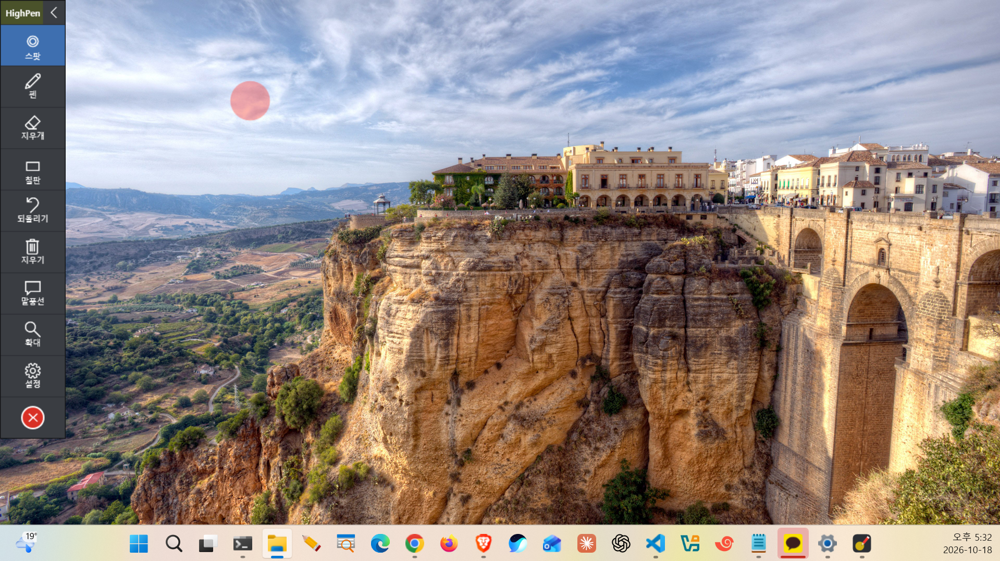
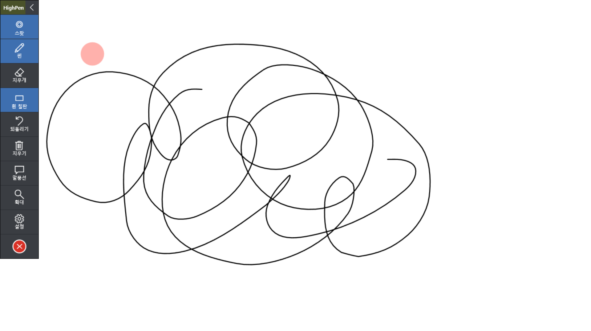
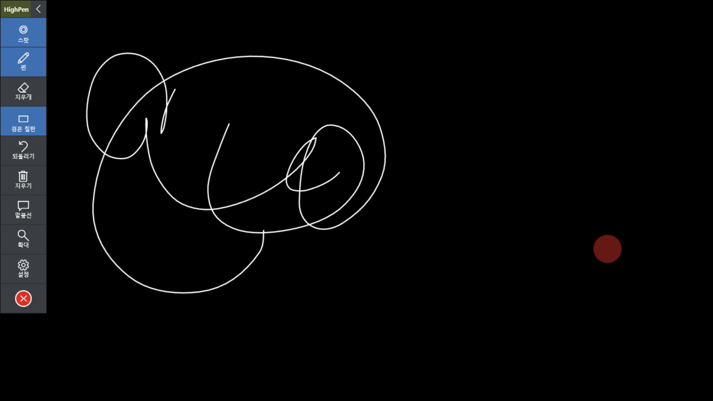
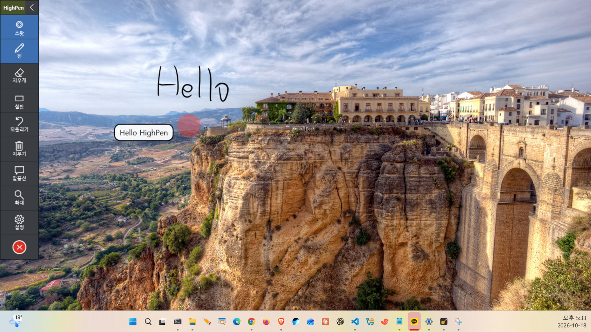

# HighPen for Windows

- **한국어:** [한국어로 된 문서는 여기를 보세요.](README.md)
- **English:** [Read this document in English.](README.en.md)
- **日本語:** 現在ご覧のドキュメントです。

[← HighPen の紹介に戻る](../README.ja.md)

オンライン授業向けの Windows 用ペンアプリです。画面に直接書き込んだり、マウスポインターをスポットで強調したり、画面を拡大したり、ボードや休憩タイマーを表示したりできます。ワコムなどのペンタブレット (Windows Ink) とマウスの両方に対応しています。



## インストール

### Microsoft Store からインストール (推奨)

[](https://apps.microsoft.com/detail/9PDG1QN5QSL3?mode=direct)

SmartScreen の警告なしでインストールされ、新しいバージョンが出ると自動で更新されます。アンインストールは Windows の設定の **インストールされているアプリ** から行います。

### winget でインストール

ターミナル (PowerShell またはコマンドプロンプト) で実行します。Microsoft Store のパッケージをインストールするので、Store からインストールした場合と同じです。

```
winget install 9PDG1QN5QSL3 --source msstore
```

- 初回のインストール時に Microsoft Store の規約への同意を求められます。`Y` を押すか、確認を省略するには `--accept-package-agreements --accept-source-agreements` を付けます。
- 名前で検索: `winget search HighPen --source msstore`
- 更新: Store が自動で更新します。手動で行う場合は `winget upgrade 9PDG1QN5QSL3`
- アンインストール: `winget uninstall 9PDG1QN5QSL3`

### インストールせずに実行

[HighPen.exe](https://github.com/stepanowon/high-pen/releases/download/v1.8.2/HighPen.exe) をダウンロードしてそのまま実行します。インストールは不要です。

### インストーラーでインストール

1. [HighPen-Setup.exe](https://github.com/stepanowon/high-pen/releases/download/v1.8.2/HighPen-Setup.exe) をダウンロードして実行します。
2. インストールするかどうかと、デスクトップにショートカットを作成するかどうかを選びます。
3. インストールが終わるとすぐに起動できます。

- インストール先: `%LOCALAPPDATA%\Programs\HighPen` (管理者権限は不要)
- スタートメニューにショートカットが作成されます。
- 同じファイルをもう一度実行すると上書きで更新されます。
- アンインストール: Windows の設定の **インストールされているアプリ** から HighPen を削除するか、インストールフォルダーの `Uninstall.exe` を実行します。保存された設定 (`%APPDATA%\HighPen`) は残ります。
- サイレントインストール/アンインストール: `HighPen-Setup.exe /S`、`Uninstall.exe /S`
- インストーラーのメッセージは Windows の表示言語に従います (韓国語、日本語、それ以外は英語)。

### ダウンロードしたファイルの確認

実行ファイルは [GitHub リリース](https://github.com/stepanowon/high-pen/releases) でのみ配布しています。コード署名がないため、ダウンロードしたファイルがリリースのものと同じかどうかを [SHA256SUMS.txt](https://github.com/stepanowon/high-pen/releases/download/v1.8.2/SHA256SUMS.txt) の値と比べて確認できます。

```powershell
Get-FileHash .\HighPen-Setup.exe -Algorithm SHA256
```

### タスクバーにピン留め

アプリを起動するとタスクバーに HighPen のアイコンが表示されます。右クリックして **タスクバーにピン留めする** を選ぶと、次からはアプリを閉じていてもアイコンから起動できます。

### 動作環境

Windows 10/11 (.NET Framework 4.8 は標準搭載のため追加インストール不要)

## 使い方

起動すると、使用モニターの左上にツールバーが表示されます。ツールバー最上段 (HighPen) をドラッグして移動でき、位置は記憶されます。`<` ボタンで折りたたみ/展開ができます。

### 言語の切り替え

既定の言語は **English** です。初回起動時はボタンやツールチップが英語で表示されます。実行中に次の手順で切り替えられます。

1. ツールバーの **Settings** ボタンを押すか `Ctrl+Alt+D` を押して設定パネルを開きます。
2. パネル下部の **Language** 項目で **日本語** (または 한국어) を押します。
3. アプリを再起動しなくてもすぐに切り替わり、使用中のペン・拡大などの状態もそのまま保たれます。

選んだ言語は自動保存され、次回起動時もそのまま使われます。

ショートカットはグローバルショートカットなので、ほかのプログラムを使っている間も動作します。ほかのプログラムがすでに使っている組み合わせは登録できません。その場合は起動直後に画面下部と設定パネルに、登録できなかったショートカットを表示します。ボタンにマウスを合わせると、名前とショートカットがツールチップで表示されます。下の表は既定のショートカットで、設定パネルの **ショートカット設定** で変更できます。

| ボタン | ショートカット | 機能 |
|---|---|---|
| スポット | Ctrl+Alt+S | マウスポインターに追従する円形スポットのオン/オフ。クリックはそのまま下の画面に届きます。 |
| ペン | Ctrl+Alt+P | 画面に書き込みます。ペンをオフにすると書き込みは画面に残り、マウスは下の画面を操作できます。消しゴム/吹き出し中はペンに切り替わります。 |
| 蛍光ペン | Ctrl+Alt+L | 半透明の太いペンで文字や図の上を塗ります。下の内容が透けて見え、ペンの書き込みより下に描かれます。もう一度押すとオフになります。 |
| 消しゴム | Ctrl+Alt+E | ストローク単位で消します。消しゴム中にもう一度押すと、現在のページのペン書き込みと吹き出しをすべて削除します。 |
| ボード | Ctrl+Alt+B | 白ボード → 黒ボード → オフの順に切り替えます。画面上の書き込みと 2 つのボードの書き込みはそれぞれ別に保持されます。 |
| 元に戻す | Ctrl+Alt+Z | 最後の書き込みまたは消しゴム操作を取り消します。 |
| 全消去 | Ctrl+Alt+C | 現在のページの書き込みと吹き出しをすべて消します。 |
| 吹き出し | Ctrl+Alt+T | クリックした位置にテキストメモを貼ります。Enter で確定、Shift+Enter で改行、Esc で取り消し。 |
| 拡大 | Ctrl+Alt+X | マウスポインターのあるモニターを 拡大します（倍率は設定で 1.5 倍・2 倍・2.5 倍から選択）。 |
| 拡大の固定 | Ctrl+Shift+X | 拡大中に拡大画面をその場で固定、または固定を解除します。固定中はマウスを動かしても拡大画面が動かず、拡大ボタンに「拡大固定」と表示されます。 |
| キャプチャ | Ctrl+Alt+F | 使用モニターの画面を書き込み・ボード・吹き出しごと PNG で保存し、クリップボードにコピーします。ツールバーとスポットは写りません。 |
| 休憩 | Ctrl+Alt+W | 休憩タイマーを開始・終了します。使用モニター全体に残り時間が大きく表示されます。 |
| 設定 | Ctrl+Alt+D | 設定パネルを開閉します。 |
| 情報 | | 作者 (名前、メール、GitHub リポジトリ) とライセンス情報を表示します。リンクを押すとメールアプリやブラウザーが開きます。 |
| `<` | Ctrl+Alt+H | ツールバーを折りたたみ/展開します。 |
| 赤い X | Ctrl+Alt+Q | 終了 |

### 設定パネル

| 項目 | ショートカット | 説明 |
|---|---|---|
| 使用モニター | Ctrl+Alt+M (切替) | アプリが動作するモニターを選びます。書き込み、スポット、ボード、ツールバーは選んだモニターにだけ表示されます。 |
| ペンの色 | Ctrl+Shift+色名 (英語) の頭文字 | 赤 R、オレンジ O、黄 Y、緑 G、青 B、紫 P、黒 K (B は青が使用)、白 W |
| ペンの太さ | | 1~30 |
| 筆圧 | Ctrl+Alt+R | ペンを強く押すほど線が太くなります。マウスは設定した太さで一定に描かれます。 |
| 蛍光ペンの色 / 太さ | | 8 色と太さ 5~60。蛍光ペンを使っている間は、ペンの色のショートカット (Ctrl+Shift+…) が蛍光ペンの色を変えます。 |
| スポットの色 / 大きさ | | 8 色と大きさ 20~200。 |
| 休憩時間 | | タイマーの長さ。10 分・15 分・1 時間・1 時間 30 分のボタンか、スライダー (5〜120 分、5 分刻み) で選びます。既定は 10 分です。 |
| クリック表示 | Ctrl+Alt+K | クリックした位置に広がる円を一瞬表示します。既定はオフです。 |
| 言語 | | 한국어、日本語、English から選ぶとすぐに切り替わります。既定は English です ([言語の切り替え](#言語の切り替え) を参照)。 |
| ショートカット設定 | | すべてのショートカットを好きな組み合わせに変更したり、なしにしたりできます ([ショートカットの変更](#ショートカットの変更) を参照)。 |
| 更新の確認 | | 押すとすぐに新しいバージョンが出ているか確認します。起動時にも自動で確認します ([自動更新](#自動更新) を参照)。Microsoft Store 版では押すと Store の HighPen のページが開き、更新があればそこで更新します。 |
| バージョン | | パネル下部に現在のバージョン (`HighPen v1.8.2`) が表示されます。 |

設定は自動保存され、`%APPDATA%\HighPen\settings.txt` にあります。

### ショートカットの変更

設定パネル下部の **ショートカット設定** を押すと、すべての機能とショートカットの一覧が開きます。

1. 変更したい機能のショートカット欄をクリックします。欄に「キーを押してください…」と表示されます。
2. 新しい組み合わせを押します。Ctrl か Alt を一緒に押す必要があり、F1~F24 は単独でも使えます。
3. すぐに保存され、ウィンドウを閉じると新しいショートカットが有効になります。

- **Esc** で入力を取り消し、**Delete** (または Backspace) でその機能のショートカットをなしにします。
- HighPen のほかの機能がすでに使っている組み合わせは、どの機能が使っているかを表示して受け付けません。
- ほかのプログラムがグローバルショートカットとして使っている組み合わせは、そのプログラムが先に受け取るため、押しても反応しません。別の組み合わせを選んでください。
- **既定に戻す** を押すと、すべてのショートカットが最初の状態に戻ります。
- ウィンドウを開いている間、HighPen のショートカットは一時的に止まります。

### 拡大中の書き込み

拡大中にペンをオンにすると拡大画面がその場で固定され、見えている位置にそのまま書き込めます。ペンをオフにすると拡大画面は再びポインターに追従します。書き込みは元の画面座標で保存されるため、拡大をオフにすると同じ内容の上に元のサイズで残ります。

## 機能説明

### マウススポット

マウスポインターに追従する半透明の円形スポットで、視聴者がポインターの位置を見つけやすくなります。

- スポットはクリックを横取りしないので、下の画面を普段どおり操作できます。
- 色 (8 色) と大きさ (20~200) は設定パネルで変更します。枠線のない、色だけの円です。
- 使用モニターに選んだモニターにだけ表示されます。

### ペン (書き込み)

画面に透明な書き込みレイヤーを重ねて、そのまま描きます。ワコムのペンとマウスの両方が使えます。


- **ペン オン:** 画面が書き込みモードになり、下の画面へのクリックはブロックされます。
- **ペン オフ:** 書いた内容は画面に残り、マウスは再び下の画面を操作します。書き込みを残したまま発表資料をめくれます。
- **色と太さ:** 8 色、太さ 1~30。色はショートカットでも変更できます。
- **筆圧:** オンにすると強く押すほど線が太くなり、設定した太さは中程度の筆圧の基準になります。マウスは設定した太さで一定です。筆圧が効かない場合は、ワコムのドライバーで Windows Ink が有効になっているか確認してください。
- **自動補正:** 線はなめらかな曲線に補正されます。

### 蛍光ペン

教材の文や図を強調するときに使います。蛍光ペンボタン (Ctrl+Alt+L) を押して描くと、半透明の太い線が引けます。

- 重ねて塗っても濃くならず、下の内容が透けて見えます。同じ場所にペンで書いた文字は蛍光ペンの上に表示されます。
- 色 (既定は黄) と太さ (既定は 20) は設定パネルの **蛍光ペンの色**、**蛍光ペンの太さ** で変更します。蛍光ペンを使っている間は、ペンの色のショートカット (Ctrl+Shift+R など) が蛍光ペンの色を変えます。
- 消しゴム、元に戻す、全消去はペンの書き込みと同じように使えます。
- ペンボタンを押すと通常のペンに戻ります。

### 消しゴム

ペンで描いたストロークの上をなぞると、そのストローク全体が消えます (ストローク単位の消去)。ワコムペンの後ろ側の消しゴムも使えます。

- 消しゴム中に Ctrl+Alt+E をもう一度押すと、現在のページのペン書き込みと吹き出しがまとめて消えます。ほかのページには影響しません。
- 再び書くにはペンボタン (Ctrl+Alt+P) を押します。

### ボード

画面全体を白または黒のボードで覆い、その上に書きます。ボードボタンを押すたびに白ボード → 黒ボード → オフと切り替わります。

- 画面上、白ボード、黒ボードの書き込みはそれぞれ別に保持されます。ボードをオフにしてまたオンにしても内容は残り、ボードの書き込みが画面上の書き込みに混ざることはありません。
- 黒ボードで黒いペン、白ボードで白いペンは見えないため、自動で反対の色に切り替わります。
- ボードでは拡大倍率が書き込みに適用されません。

| 白ボード | 黒ボード |
|---|---|
|  |  |

### 元に戻す / 全消去

- **元に戻す:** 現在のページで最後の操作を取り消します。ペンで描いた 1 ストローク、または消しゴムで 1 回なぞって消したストロークが 1 段階です。全消去も 1 段階として元に戻せ、そのとき消した吹き出しも一緒に戻ります。吹き出しを 1 つずつ元に戻すことはできません。
- **全消去:** 現在のページの書き込みと吹き出しをすべて消します。ほかのページ (画面上、白ボード、黒ボード) には影響しません。

### 吹き出し

画面にテキストメモを貼る機能です。手書きの代わりに、用語や説明をはっきりした文字で残したいときに使います。

1. 吹き出しボタン (Ctrl+Alt+T) を押します。ポインターが文字入力の形に変わります。
2. 文字を置きたい位置をクリックして内容を入力します。
3. **Enter** で確定します。**Shift+Enter** は改行、**Esc** は取り消しです。

- 白い背景に現在のペンの色の枠線がある角丸の箱で表示され、文字の大きさはペンの太さに比例します。
- 1 つ入力すると通常のペンモードに戻ります。複数貼るときはその都度ボタンを押し直します。
- 作成後は移動や編集はできず、全消去でのみ削除できます。
- 現在のページ (画面上、白ボード、黒ボード) に貼られ、ページごとに別に保持されます。



### 画面拡大

マウスポインターのあるモニターをリアルタイムで拡大します。倍率（1.5 倍・2 倍・2.5 倍）は設定パネルで選べ、拡大中に変更してもすぐに反映されます。


- ポインターの下にある内容が拡大後もポインターの真下に来るよう、画面が追従して動きます。見えている位置をそのままクリックできます。
- ツールバーは拡大されず、元の大きさのままです。
- 拡大をオンにした時点でポインターがあったモニターが拡大され、拡大中はポインターがそのモニターの外に出ません。ほかのモニターを拡大するには、拡大をオフにしてポインターを移動し、再びオンにします。
- 拡大中に使用モニターを変更すると、拡大は自動的にオフになります。
- **拡大画面の固定 (Ctrl+Shift+X):** 拡大中に押すと拡大画面がその場で固定され、マウスを動かしても画面があちこち動きません。拡大ボタンの名前が「拡大固定」に変わります。もう一度押すと再びポインターに追従します。拡大をオフにすると固定も解除されます。
- 固定中は、見えている画面と実際にクリックされる位置が異なります。固定した画面では説明やペンでの書き込みに使い、クリックするときは固定を解除してください。
- **拡大中の書き込み:** ペンをオンにすると拡大画面がその場で固定され、見えている位置にそのまま書き込めます。ペンをオフにすると拡大画面は再びポインターに追従します。書き込みは元の画面座標で保存されるため、拡大をオフにすると同じ内容の上に元のサイズで残ります。拡大画面でほかの場所に移るには、ペンをオフにしてポインターを移動し、再びオンにします。

### キャプチャ

ボードや画面上の書き込みを授業資料として残すときに使います。キャプチャボタン (Ctrl+Alt+F) を押すと、使用モニターに見えているとおり (画面、書き込み、ボード、吹き出し、拡大画面) に撮影します。

- **保存先:** `ピクチャ\HighPen\HighPen_日付_時刻.png`。同じ画像がクリップボードにもコピーされるので、すぐに貼り付けられます。
- ツールバーとマウススポットは写りません。
- キャプチャ後、画面下部に保存先が一瞬表示され、クリックするとエクスプローラーでフォルダーが開きます。

### 休憩タイマー

授業中の休憩時間に残り時間を表示します。休憩ボタン (Ctrl+Alt+W) を押すと使用モニター全体が暗くなり、残り時間が大きく表示されるため、画面共有で見ている受講者にもすぐ分かります。

- **時間の設定:** 設定パネルの **休憩時間** で、10 分・15 分・1 時間・1 時間 30 分のボタンかスライダー (5〜120 分、5 分刻み) で選びます。選んだ時間は保存され、次回起動時も使われます。タイマーの動作中に変更すると、次の休憩から反映されます。
- 残り時間の下に再開時刻 (例:「13:26 に再開します」) が表示され、最後の 1 分はオレンジ色に変わります。
- 時間になると赤い 00:00 と「休憩時間が終わりました」が表示されたまま残ります。休憩ボタンか Ctrl+Alt+W をもう一度押すと閉じます。
- タイマー画面はクリックを通すので休憩中も PC をそのまま使え、ツールバーはタイマー画面の上に表示されたままです。

### クリック表示

録画や画面共有で、どこをクリックしたか視聴者に分かるよう、クリックした位置に円が広がって消えます。設定パネルの **クリック表示** または Ctrl+Alt+K でオン/オフします。

- 左クリックは実線、右クリックは点線の円で、色はスポットの色に従います。
- 使用モニターでのみ表示され、ペンで書き込んでいる間は表示しません。

### マルチモニター

設定パネルの **使用モニター** (または Ctrl+Alt+M) で、アプリが動作するモニターを選びます。書き込み、スポット、ボード、ツールバーはそのモニターにだけ表示され、ほかのモニターは普段どおり使えます。モニターを切り替えても既存の書き込みと吹き出しは保持されます。番号は Windows のディスプレイ設定の番号と同じです。実行中にモニターを接続したり外したりすると、モニター一覧とウィンドウ位置を自動で合わせ直します (拡大中だった場合、拡大はオフになります)。使用モニターの接続が切れると 1 秒以内にメインモニターへ移動し、そのモニターを再接続すると元のモニターに戻ります。モニターの順序が変わっても、選んだモニターを記憶します。

### ツールバー

- 最上段 (HighPen) をドラッグして移動すると位置が保存され、次回起動時も同じ場所に表示されます。保存された位置が画面外の場合は左上に戻ります。
- ツールバーは使用モニターの外に出ません。ドラッグで移動するときも、展開や設定パネルを開いて大きくなるときも、使用モニターの作業領域 (タスクバーを除く) 内に収まります。
- 最上段の左にある `<` ボタンで折りたたみ/展開ができます。折りたたむと HighPen のタイトルも消えて `>` ボタンだけが残り、ツールバーの後ろに隠れていた画面をクリックできます。`>` を押すと同じ位置にもう一度展開します。折りたたんだ状態ではツールバーをドラッグで移動できません。

- 設定パネルはツールバーの右側に開き、ツールバーが画面の右端にあって空きが足りない場合は左側に開きます。
- 各ボタンにマウスを合わせると、名前とショートカットがツールチップで表示されます。
- クリックしても、発表中の画面からフォーカスを奪いません。
- 実行中はタスクバーにアイコンが表示され、ピン留めできます。

### 自動更新

GitHub から入手した `HighPen.exe` または `HighPen-Setup.exe` を使っている場合、HighPen は起動するたびに新しいバージョンが出ているか確認します。Microsoft Store 版は Store が自動で更新するため、確認しません。

- 新しいバージョンがあると、使用モニターの中央に更新ウィンドウが表示されます。**Microsoft Store で入手** を押すと Microsoft Store に HighPen のページが開くので、そこでインストールします。**後で** を押すと次回起動時にまたお知らせします。**変更内容を見る** を押すとリリースページが開きます。
- 新しいバージョンは GitHub からダウンロードせず、Microsoft Store からインストールします。GitHub の実行ファイルにはコード署名がありませんが、Store のパッケージは Microsoft が署名しているためです。以後は Store が自動で更新します。
- Store 版をインストールしたら、今まで使っていた HighPen を終了し、Windows の設定の **インストールされているアプリ** から削除してください。インストールせずに `HighPen.exe` を使っていた場合は、そのファイルを削除してください。設定は Store 版でもそのまま使われます。
- 自分で確認するには、設定パネルの **更新の確認** ボタンを押します。新しいバージョンがあれば更新ウィンドウが表示され、なければ「最新バージョンです」、確認できなければインターネット接続を確認するようにというお知らせが画面下部に少しの間表示されます。
- 起動時の自動確認は、新しいバージョンがあるときだけウィンドウを表示し、インターネットに接続していないときは何も表示しません。

### 設定の保存

ペンの色、太さ、筆圧、蛍光ペンの色と太さ、変更したショートカット、スポットの色と大きさ、スポットのオン/オフ、クリック表示、拡大倍率、休憩時間の長さ、使用モニター、ツールバーの位置、言語が `%APPDATA%\HighPen\settings.txt` に自動保存され、次回起動時もそのまま使われます。

## 注意 / 制限事項

- 実行ファイルにコード署名がないため、Web から直接ダウンロードすると Windows SmartScreen の警告が表示されることがあります。Microsoft Store または winget でインストールするか、警告画面で **詳細情報 → 実行** を押してください。
- モニターごとに表示スケールが異なる環境では、拡大やツールバーの位置がずれることがあります。
- USB-C↔HDMI などの変換アダプター経由で接続したモニターは、モニター側のケーブルを抜いても Windows が切断として扱わないことがあります。この場合 HighPen も移動しないため、アダプターを PC から抜くか、ディスプレイ設定の **このディスプレイを切断する** を使ってください。
- 拡大中にペンを使うには、拡大画面がポインターに追従しないようペンをオンにしておく必要があります。

## プライバシー

このプログラムは、起動時に GitHub で新しいバージョンを確認すること ([自動更新](#自動更新)。Microsoft Store 版は行いません) を除き、ユーザーまたはインストール・運用する人が明示的に要求しない限り、いかなる情報もほかのネットワークシステムに送信しません。情報ウィンドウと更新ウィンドウのリンクを押したときにのみ、ブラウザーやメールアプリが開きます。 詳しくは[プライバシーポリシー](../PRIVACY.md#日本語)をご覧ください。

## ライセンス

[MIT License](../LICENSE) で公開しています。商用利用を含め自由に使用・改変・再配布できますが、再配布の際は著作権表示とライセンス文を含める必要があります。
